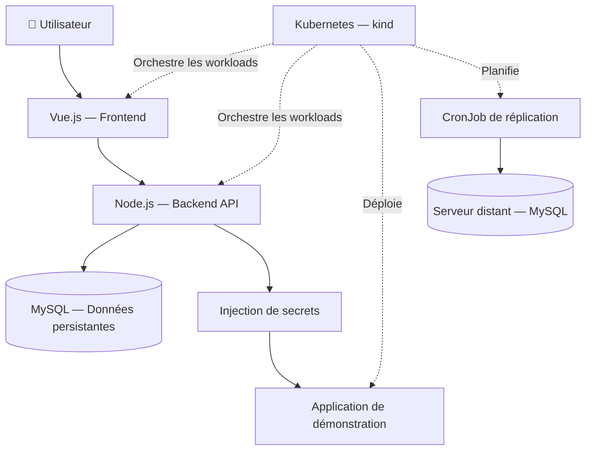

# kvault


## Run la db de test :

### créer le conteneur 

```bash
docker run --name db -e MYSQL_ROOT_PASSWORD=1234 -p 3306:3306 -d mysql:latest
docker exec -it db bash
mysql -u root -p (code "1234")
CREATE DATABASE kvault;
```
### Y mettre le contenue de db-scheme.txt

## Run le Front et le Back 

`npm run dev`


# 🔐 KVault — Secure Secrets Management

<p align="center">
  <strong>Un mini-coffre-fort numérique conçu pour sécuriser, gérer et injecter des secrets dans des applications conteneurisées.</strong>
</p>

<p align="center">
  
  
  
  
</p>

---

## 📌 Présentation

**KVault** est un projet de cybersécurité visant à concevoir un coffre-fort numérique permettant de centraliser et de protéger des informations sensibles : mots de passe, clés API, identifiants et autres secrets applicatifs.

Le projet repose sur une architecture composée d'une interface web, d'une API backend et d'une base de données, avec une infrastructure Kubernetes permettant d'isoler les différents composants et d'étudier des mécanismes sécurisés d'injection de secrets.

L'objectif est de mettre en pratique des principes essentiels de sécurité applicative et de DevSecOps : protection des données, authentification, séparation des responsabilités, gestion des secrets et déploiement conteneurisé.

## 🎯 Objectifs du projet

- 🔒 **Confidentialité** — protéger les données sensibles et limiter leur exposition.
- 🛡️ **Authentification** — contrôler l'accès aux ressources protégées.
- 🧱 **Isolation** — séparer les composants applicatifs et leur infrastructure.
- ☸️ **Orchestration** — déployer les services dans un environnement Kubernetes.
- 🔑 **Secret injection** — permettre à une application de démonstration de recevoir les secrets dont elle a besoin sans les intégrer directement à son code.
- ⚙️ **Automatisation** — explorer les mécanismes de réplication et de sauvegarde de la base de données.

## ✨ Fonctionnalités et périmètre

| Fonctionnalité | Description |
|---|---|
| 🔐 Authentification | Connexion et contrôle d'accès aux ressources du coffre-fort |
| 🗝️ Gestion des secrets | Centralisation des informations sensibles |
| 🔒 Chiffrement | Conception d'un mécanisme de protection des données du coffre |
| 🔎 Validation des sessions | Vérification des jetons d'authentification via l'API |
| 🖥️ Interface web | Interface utilisateur développée avec Vue.js |
| ☸️ Déploiement Kubernetes | Déploiement des composants applicatifs dans un cluster local `kind` |
| 🔌 Injection de secrets | Mise à disposition de secrets pour une application de démonstration |
| 🔄 Réplication de base de données | Exploration d'une réplication automatisée vers un serveur distant |

*Le périmètre ci-dessus décrit les fonctionnalités visées par le projet. Leur disponibilité effective dépend de l'état d'avancement de l'implémentation.*

## 🏗️ Architecture

KVault sépare l'application de son environnement d'exécution afin de faciliter l'isolation, le déploiement et l'évolution de chaque composant.



### 🧩 Composants

- **Frontend — Vue.js** : interface web permettant à l'utilisateur d'interagir avec le coffre-fort.
- **Backend — Node.js** : API chargée de l'authentification, de la validation des accès et du traitement des requêtes.
- **Base de données — MySQL** : stockage des données persistantes de l'application.
- **Infrastructure — Kubernetes / kind** : environnement local d'orchestration pour les différents composants.
- **Application de démonstration** : service distinct destiné à tester les mécanismes d'accès et d'injection de secrets.
- **Réplication — CronJob** : mécanisme planifié envisagé pour répliquer les données vers un serveur distant.

## 🛠️ Stack technique

| Technologie | Utilisation |
|---|---|
| Vue.js | Interface utilisateur |
| Node.js | API backend |
| MySQL | Base de données relationnelle |
| Docker | Conteneurisation |
| Kubernetes | Orchestration des services |
| kind | Cluster Kubernetes local |
| NGINX Ingress | Routage HTTP/HTTPS vers les services |
| Terraform / Ansible | Technologies d'infrastructure étudiées dans le contexte DevSecOps |

## 🔐 Approche sécurité

La sécurité est un axe central de KVault. Le projet vise à appliquer plusieurs mécanismes de défense complémentaires.

### Authentification et sessions

L'architecture prévoit des jetons d'authentification opaques, stockés côté serveur et validés par l'API. Une route de vérification dédiée permet de contrôler la validité d'un jeton avant d'autoriser l'accès aux ressources protégées.

### Protection des données

Le coffre-fort est conçu autour d'un mécanisme de chiffrement des secrets. La gestion des clés doit limiter leur exposition et distinguer les données chiffrées des éléments nécessaires à leur déchiffrement.

### Isolation et gestion des secrets

Les services sont séparés au sein de l'environnement Kubernetes. Les secrets d'infrastructure doivent être gérés indépendamment du code source et ne pas être exposés inutilement aux conteneurs.

### Communication sécurisée

L'utilisation de HTTPS et d'un Ingress configuré avec TLS vise à protéger les communications entre le client et les services exposés.

### Sauvegarde et réplication

La réplication vers un serveur distant constitue un axe de travail pour améliorer la résilience des données. Elle devra être accompagnée de contrôles d'accès, d'une sécurisation des transferts et de procédures de restauration vérifiées.

> **Principe fondamental :** un secret ne doit être accessible qu'aux composants et aux utilisateurs qui en ont réellement besoin.

## 🚀 Environnement de développement

### Prérequis

- [Docker](https://www.docker.com/)
- [Node.js](https://nodejs.org/)
- [Kubernetes](https://kubernetes.io/)
- [kind](https://kind.sigs.k8s.io/)
- Git

### Récupérer le projet

```bash
git clone <URL_DU_DEPOT>
cd kvault
```

### Démarrage

Les commandes de démarrage dépendent de la configuration actuelle du dépôt. Le processus de déploiement prévu comprend les étapes suivantes :

1. Configurer les variables d'environnement et les paramètres de la base de données.
2. Construire les images Docker du frontend et du backend.
3. Démarrer ou sélectionner le cluster Kubernetes local `kind`.
4. Déployer les composants applicatifs et la base de données.
5. Configurer les services, l'Ingress et le certificat TLS.
6. Vérifier l'authentification, l'accès aux secrets et le bon fonctionnement de l'application de démonstration.

Les secrets, mots de passe et clés privés ne doivent pas être ajoutés au dépôt Git.

## 🗺️ Évolutions envisagées

- [ ] Finaliser les parcours d'authentification et de gestion des sessions.
- [ ] Finaliser et tester le chiffrement et le cycle de vie des clés.
- [ ] Mettre en place une injection de secrets avec des droits minimaux.
- [ ] Automatiser le déploiement de l'infrastructure.
- [ ] Sécuriser et valider la réplication de la base de données.
- [ ] Ajouter des tests automatisés et des contrôles de sécurité.
- [ ] Documenter les procédures de sauvegarde et de restauration.

## 🎓 Contexte du projet

KVault est un projet de mise en pratique des compétences en **cybersécurité, développement backend, conteneurisation, Kubernetes et DevSecOps**.

Il permet d'explorer les problématiques rencontrées lorsqu'une application doit gérer des données sensibles dans un environnement distribué : contrôle des accès, protection des clés, isolation des services et sécurisation de l'infrastructure.

## ⚠️ Avertissement

KVault est un projet de développement et d'expérimentation. Il ne doit pas être utilisé pour stocker des secrets de production sans audit de sécurité, tests approfondis et validation de l'architecture.

---

<p align="center">
  <strong>KVault — Security by design. Secrets under control.</strong>
</p>
